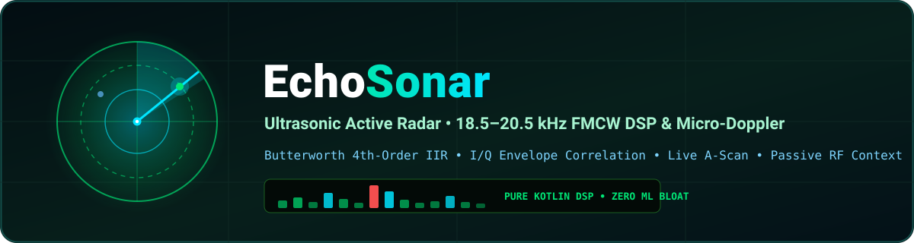
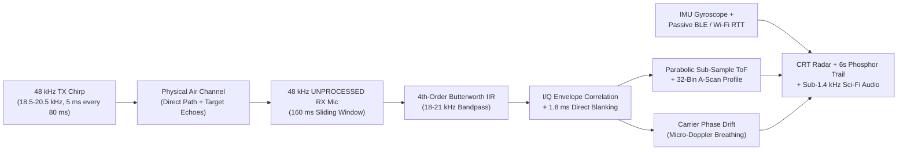

<p align="center">
  
</p>

<p align="center">
  
  
  
  
  
</p>

# 🦇 EchoSonar — Ultrasonic Active Radar & Micro-Doppler DSP

**EchoSonar** is an experimental, pure-Kotlin Android active sonar & environmental radar application created by **[@ferzferax](https://github.com/ferzferax)**. It turns a smartphone's earpiece/speaker and microphone into an inaudible **18.5–20.5 kHz FMCW ultrasonic rangefinder**, complete with a retro CRT polar radar, a live **32-bin A-Scan echo oscilloscope**, carrier-phase **micro-Doppler** detection, and passive **BLE / Wi-Fi RF** context telemetry.

Originally extracted from a multi-sensor acoustic research prototype (`AudioMonitor`), **EchoSonar** now lives as a standalone, lightweight repository with **zero TFLite / ML dependencies**.

---

> [!IMPORTANT]
> **Early-Stage Experimental Project Notice**  
> This is an **initial / early-stage open-source project** with a lot of hardware-specific tuning still ahead (different Android phones have very different ultrasonic speaker/mic sensitivity curves around 19 kHz!). I published this code openly so fellow developers and hardware enthusiasts can **inspect the DSP math, test it on real devices, calibrate SNR/blanking parameters, and contribute improvements.**

---

## 🔬 Signal Processing Architecture



---

## ✨ Key Features (`v0.1.0-alpha`)

- **Pure Kotlin Ultrasonic FMCW DSP:**
  - Transmits a Tukey-windowed `18.5–20.5 kHz` linear chirp (`5 ms`) at `48 kHz` every `80 ms`.
  - Self-synchronizes on the speaker-to-mic direct wave (`t = 0`), making range math **100% immune to Android AudioTrack/AudioRecord hardware latency jitter**.
  - Blanks the first **`1.8 ms` (`>= 84` samples ≈ `30 cm`)** to filter out internal phone chassis ringing and capacitive bleed.
- **Live 32-Bin A-Scan Echo Oscilloscope:** Real-time normalized echo reflection envelope (`0.3 m – 3.0 m`) rendered directly beneath the CRT radar so you can see physical wall/object reflections even before crossing the SNR gate.
- **Spatial Azimuth Mapping & 6-Second Phosphor Persistence:** Pan your phone left/right (`-45°` to `+45°`) and tap **`0° Recenter`** to paint a decaying phosphor persistence map of nearby obstacles.
- **Micro-Doppler Classification:** Distinguishes **Solid Walls / Rigid Reflectors** (narrow correlation peak), **Soft Objects / Passages**, and **Living Presence** (tracking sub-millimeter carrier phase excursion `~1 rad ≈ 1.4 mm` at `19.5 kHz` + optional BLE/Wi-Fi stationary hint).
- **Live Calibrated Controls:**
  - **Cadence & EMA Smoothing Slider (`50 ms – 240 ms`)** wired directly to distance EMA filtering.
  - **SNR Sensitivity Gate Slider (`1.8x – 4.5x`)** to tune false-echo rejection on any phone model.
  - **Sci-Fi Motion Tracker Audio (`🔊 / 🔇`):** Real-time synthesized proximity telemetry strictly below `1.4 kHz` (completely isolated below the `18–21 kHz` ultrasonic sonar band).
- **Bilingual UI (`🌐 EN / PT`):** Starts in **English** by default with 1-tap toggle to **Portuguese (PT-BR)** across radar labels, tilt guidance, and the built-in acoustic manual.

---

## 🚀 Step-by-Step Guide

### Option A: Install Pre-Built APK on Android

1. Download **`EchoSonar.apk`** from the [GitHub Releases](https://github.com/ferzferax/EchoSonar/releases) page.
2. Install on Android (`Android 8.0+ / API 26+`):
   ```bash
   adb install -r EchoSonar.apk
   ```
3. Grant **Microphone** permission (required for ultrasonic echo capture) and optional **Location / Nearby Devices** permissions (for passive BLE/Wi-Fi RF context telemetry).
4. **How to Test for Best Results:**
   - **Grip:** Hold the phone gently along the **middle side edges** — never cover the top earpiece/mic vent or the bottom speaker/mic beside USB-C (skin absorbs `19 kHz` ultrasound immediately).
   - Tap **0°** while facing open space, tap **START**, then point at a flat wall `0.5 m – 2.5 m` away or slowly sweep horizontally across doorways and objects!
   - Watch both the **CRT Radar** and the **A-Scan Echo Envelope** strip while adjusting the **SNR Gate** slider (`2.6x` default).

---

### Option B: Build from Source (Android Studio / Gradle)

> [!TIP]
> **Requirements:** JDK 17 and Android SDK (Compile SDK 36, Min SDK 26). No NDK or TFLite assets needed!

1. **Clone the Repository:**
   ```bash
   git clone https://github.com/ferzferax/EchoSonar.git
   cd EchoSonar
   ```
2. **Configure Local SDK Path:**
   Create `local.properties` in the root folder:
   ```properties
   sdk.dir=C\:\\Users\\YOUR_USER\\AppData\\Local\\Android\\Sdk
   ```
3. **Compile & Install:**
   ```bash
   ./gradlew assembleRelease assembleDebug
   adb install -r app/build/outputs/apk/debug/app-debug.apk
   ```

---

## 📂 Repository Structure

```text
EchoSonar/
├── .github/ISSUE_TEMPLATE/
│   └── bug_report.md
├── app/src/main/
│   ├── AndroidManifest.xml                  # Audio + passive BLE/Wi-Fi telemetry permissions
│   ├── kotlin/com/example/audiomonitor/
│   │   ├── MainActivity.kt                  # 2-tab Radar/Guide UI + top bar EN/PT toggle
│   │   ├── sonar/
│   │   │   ├── SonarDSPProcessor.kt         # FMCW chirp, 4th-order Butterworth, I/Q ToF & A-Scan
│   │   │   ├── SonarEngine.kt               # Full-duplex 48 kHz TX/RX + EMA + 6s phosphor map
│   │   │   ├── SciFiAudioSynthesizer.kt     # Continuous Alien Motion Tracker synth (< 1.4 kHz)
│   │   │   ├── OrientationTracker.kt        # Bi-modal pitch/roll alignment & azimuth tracker
│   │   │   └── RfContextProvider.kt         # Passive BLE + Wi-Fi RSSI/RTT telemetry provider
│   │   └── ui/
│   │       ├── sonar/SonarScreen.kt         # Polar CRT Radar Canvas + A-Scan + Live Sliders
│   │       ├── help/HelpScreen.kt           # Bilingual ultrasonic & grip manual
│   │       └── theme/                       # Material 3 dark radar palette
│   └── res/drawable/                        # Custom ultrasonic radar vector adaptive icon
├── assets/echosonar_banner.svg
├── CHANGELOG.md
├── CONTRIBUTING.md
├── LICENSE                                  # MIT License
└── README.md
```

---

## 🙏 Credits

- **Creator & Maintainer:** [@ferzferax](https://github.com/ferzferax)
- **Companion Acoustic ML Project:** [HeardWord — Neural Audio Monitor](https://github.com/ferzferax/HeardWord) (split into its own dedicated repository).

---

## 📄 License

Released under the **MIT License** — see [`LICENSE`](LICENSE) for details.
